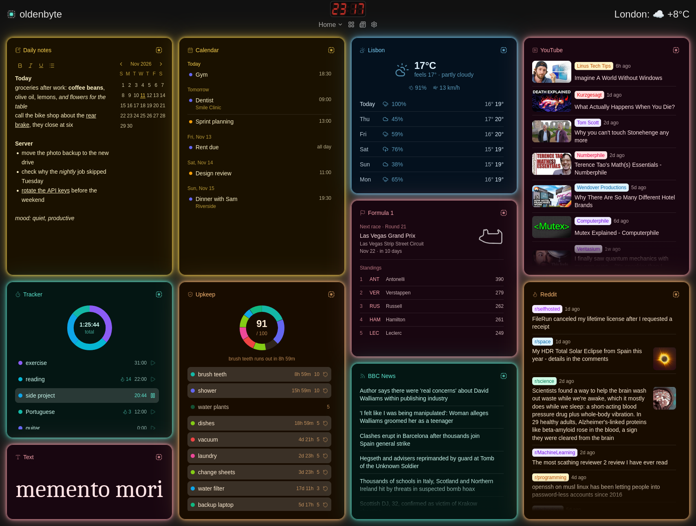

# oldenbyte

A self-hosted personal dashboard. Drag and resize widgets, keep several dashboards, and let a local AI assistant read what is on them.



## Highlights

- **Many dashboards**, each with its own layout. Group widgets as tabs, move them between dashboards.
- **Accounts**: the first visit creates the admin; others join with an invite code.
- **Keyboard driven**: press Space, then a widget's number or an action key. See [docs/keyboard.md](docs/keyboard.md).
- **AI assistant** for any OpenAI-compatible model (Ollama, LM Studio, llama.cpp, ...). It reads your widgets, Kiwix and Anytype on request, with characters that keep their own memory.
- **Morning digest** at `/digest`: a newspaper-style briefing of your widgets.
- **Your data**: Settings shows everything stored for your account. Backups export and import from edit mode.
- Works on phones.

## Widgets

| | |
|---|---|
| **Notes** | Notepad (daily, with a calendar), Text, Bookmarks |
| **Reading** | Feed (RSS, with favorites), Reddit, YouTube (with TubeArchivist), arXiv, HF Daily, Reader (PDF and EPUB), Kiwix, Anytype |
| **Time** | Calendar (CalDAV), Schedule, Tracker, Rhythm, Upkeep |
| **Other** | Weather, F1, Deficit, Typing, Chess (Stockfish), TV (IPTV), Assistant |

New widgets can also be single JSON files in `widget-bank/`, no React needed. See [docs/widget-bank.md](docs/widget-bank.md).

Each widget is documented in [docs/widgets/](docs/widgets/).

## Run it

With Docker:

```bash
echo "SESSION_SECRET=$(openssl rand -hex 32)" > .env
mkdir -p data && touch data/db.sqlite && chmod 666 data/db.sqlite
docker compose up -d
```

Open port `3847` and create the admin account. Data lives in `./data/`.

For development:

```bash
npm install
npm run dev        # http://localhost:3000
npm run typecheck && npm run lint && npm test
```

## Stack

Next.js 16, TypeScript, Tailwind CSS 4, Prisma with SQLite, react-grid-layout. Architecture, API, storage and deployment are in [docs/](docs/).

## Credits

- F1 circuit outlines by [Jules Roy](https://github.com/julesr0y/f1-circuits-svg), [CC BY 4.0](https://creativecommons.org/licenses/by/4.0/)
- [Stockfish](https://stockfishchess.org/) via [stockfish.js](https://github.com/nmrugg/stockfish.js), [GPL-3.0](https://www.gnu.org/licenses/gpl-3.0.html)

## License

[MIT](LICENSE)
