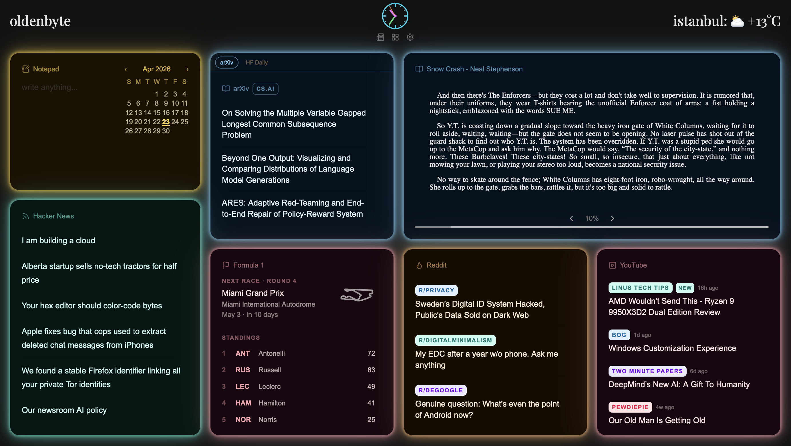
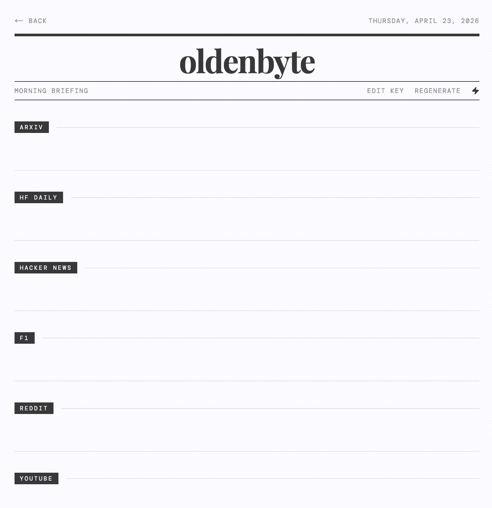

# oldenbyte

A personal dashboard built with Next.js. Widgets are draggable, resizable, and persist their state to a local SQLite database. Multiple named dashboards, each with its own layout and widgets, switchable from the top bar. Multiple accounts, each with its own dashboards. Responsive for mobile portrait view.



## Widgets

- **Notepad** - a daily notepad with a built-in calendar to browse past entries; multiple instances each get a numbered tab when browsing a past date; renameable
- **Reader** - read PDF or EPUB files from your own library folder (browse subfolders, upload, or fill it from outside), with full-screen view, saved position, and a Kindle-style progress bar
- **Text** - display any static text or a live string fetched from a URL endpoint
- **Feed** - subscribe to any RSS feed, configurable item count
- **Reddit** - top posts from one or more subreddits, selectable time period and post count, newest first, with optional post images; each subreddit paints as it arrives
- **YouTube** - latest videos from one or more channels, sorted newest-first with a "new" badge for uploads under 24 hours; Shorts and members-only videos can be filtered out per channel, list, thumbnail or gallery view, and archived videos can open on your own [TubeArchivist](https://www.tubearchivist.com/)
- **Weather** - current conditions and a daily forecast for any place (search by name, °C/°F toggle), refreshed every 30 minutes
- **F1** - next race details with countdown and current top 5 driver standings, updated hourly
- **arXiv** - latest papers from a chosen research field (CS, Math, Physics, and more), with abstract view on click; falls back to the newest submissions when the daily feed is empty on weekends
- **HF Daily** - trending AI papers curated by Hugging Face, sorted by upvotes
- **Calendar** - upcoming events from any CalDAV server (Nextcloud, Radicale, ...); connect once, pick which calendars to show, and set the agenda window
- **Schedule** - your fixed weekly routine on a seven-day time grid; click a slot to add, drag to move, entries can repeat across days and run past midnight
- **Tracker** - time how long you spend on each activity with a one-tap stopwatch (only one runs at a time) and a donut chart of the day's breakdown; keeps a full per-day history with streaks, week-over-week stats, and editable past durations, and time that crosses midnight is credited to the day it happened in
- **Rhythm** - tap to log habits (one-tap moments or timed sessions) and see how often and at what time of day you do them
- **Upkeep** - a weighted daily checklist of essentials that keeps the day's score at 100
- **Bookmarks** - your favorite links as favicon tiles, tiles with names, rows, or a names-only list
- **Typing** - a Monkeytype-style typing trainer with words, time, drill and metronome modes; it learns your weak keys and drills them, and counts wpm, raw, accuracy and characters the way Monkeytype does
- **Chess** - play an ongoing game against the Stockfish engine with an adjustable Elo difficulty; the game persists between visits
- **TV** - watch live IPTV channels (for example an [ErsatzTV](https://ersatztv.org/) playlist), streamed through the server so a LAN http source works on an https dashboard
- **Kiwix** - search an offline [Kiwix](https://kiwix.org/) library (Wikipedia, WikiHow, …) running on your network; enter the server URL, pick a book, and full-text search results link straight to the article
- **Anytype** - browse and search your own [Anytype](https://anytype.io/) spaces; pair once with the local desktop app (a 4-digit code), pick a space, then search your objects with results that open straight in Anytype
- **Chat** - chat with any OpenAI-compatible model (Ollama, LM Studio, llama.cpp, vLLM, OpenAI, …) by entering the API URL and model name; responses stream in real-time and the conversation persists. Highlights:
  - **Dashboard lookup** toggle hands the model `read_widget` and `search_dashboard` tools so it reads your notes, feeds, and tracked time on demand ("what's new on arXiv?", "what did I note last Tuesday?"), with paging and keyword-find for long content; you choose per widget what it may read. A separate **calendar** toggle lets it list and create events through the Calendar widget's account
  - **Kiwix lookup** toggle hands the model search tools for an offline [Kiwix](https://kiwix.org/) library (agentic RAG) so it can look facts up mid-conversation and cite what it read
  - **Anytype lookup** toggle does the same for your own [Anytype](https://anytype.io/) notes - it searches, reads (with `find`/page navigation for long notes), and can map-reduce **summarize** a whole journal too big to fit in context, while honouring each note's dates and metadata
  - **Characters** - create personas, each with its own system prompt and a private, *scoped* long-term memory: give one a focus (e.g. an education coach) and it auto-remembers what you tell it that fits (your studies) while ignoring the rest (your trip)
  - **Model control** - for Ollama/LM Studio, a status pill shows whether the model is loaded and lets you set how long it lingers in VRAM, pin it, or unload it on demand
  - Regenerate a reply from any of your messages, edit your past messages to rewind, and an auto-growing composer for multi-line input

## Community widget bank

Widgets can also be defined as single JSON files in `widget-bank/`: declare a URL to fetch and map fields onto a small set of themed primitives (lists, stat rows, sparklines, ...), no React required. Valid definitions appear in the edit-mode picker under **Community**; invalid ones are skipped with reported errors. See [docs/widget-bank.md](docs/widget-bank.md).

## Morning digest



`/digest` is a separate page that reads today's cached widget data and generates a newspaper-style AI briefing using any OpenAI-compatible model - a local one (Ollama, LM Studio, llama.cpp) or a hosted provider. Set the endpoint URL, model, and optional API key via the **model** control in the masthead (stored in `localStorage`). Each widget section gets its own API call, running in parallel. A streaming mode toggle streams each section's text in real-time as it's generated. Accessible from the main dashboard via the newspaper icon in the top bar.

## Top bar

The left and right text fields are editable and can display either a static string or a live value fetched from any URL that returns plain text (for example a weather or IP address endpoint). The center shows a configurable date or clock with the action buttons (dashboard switcher, digest, layout edit, settings) grouped below it. On phones the two text fields share the first row and the date with its buttons sits on a row below. The switcher creates, renames, and deletes dashboards. The settings panel holds your account (username, log out, change password, and a link to the admin page for admins), dark mode, the timezone, **Preload dashboards** (mount every dashboard in the background at page load so switching is instant; otherwise each mounts on first visit and then stays), and demo mode (preview the first-run dashboards with sample data; nothing you change there is saved). Dark mode preference is persisted to the database, and pressing **Shift+D** toggles it from anywhere (except while typing in a field).

The dashboard is keyboard-driven too, and works alongside Vimium: press **Space**, then a widget's number to focus it (a tab group then takes a tab number or q w e r t), or a key for an action: **e** settings, **r** refresh, **[** and **]** switch dashboards, **n** new dashboard, **l** edit layout, **?** the cheat sheet. Settings > Keyboard turns this off and rebinds every key. See [docs/keyboard.md](docs/keyboard.md).

## Accounts

The first visit creates the admin account. Further accounts join with an invite code: the admin turns registration on and sets the code on `/admin`, where they can also reset passwords, delete accounts, and set how long the server caches feeds. Every account has its own dashboards and files. Only admin accounts can point integrations (Kiwix, CalDAV, Anytype, TubeArchivist, TV, local models) at addresses on the LAN or tailnet; other accounts are limited to public addresses. See [docs/auth.md](docs/auth.md).

Feeds (Feed, Reddit, YouTube, arXiv, HF Daily) are cached on the server for that admin-set time, so a page load does not hit every source; each feed widget has a refresh button that fetches fresh data.

## Stack

- **Next.js 16** with App Router and TypeScript
- **Tailwind CSS v4** for styling
- **Prisma + SQLite** for persistent storage
- **react-grid-layout** for drag and drop widget management
- **react-pdf** and **epubjs** for document rendering
- **chess.js** and **react-chessboard** with **Stockfish** (WebAssembly) for the chess widget
- **hls.js** and **mpegts.js** for the TV widget
- **Vitest** and **ESLint** for tests and lint

## Development

```bash
npm install
npm run dev
```

The app runs at `http://localhost:3000`. A local SQLite database is created automatically on first run (`prisma/dev.db`, or wherever `DATABASE_URL` points), and the first visit asks you to create the admin account.

Checks (CI runs all three before building an image):

```bash
npm run typecheck   # tsc --noEmit
npm run lint        # eslint
npm test            # vitest unit tests in tests/
```

Docs for the architecture, API, storage keys and each widget live in [docs/](docs/).

## Self-hosting with Docker

**1. Create a `.env` file** next to `docker-compose.yml`:

```
SESSION_SECRET=<random hex string>
```

Generate a secret with:

```bash
openssl rand -hex 32
```

**2. Initialize the data directory:**

```bash
mkdir -p data
touch data/db.sqlite
chmod 666 data/db.sqlite
```

**3. Start the container:**

```bash
docker compose up -d
```

The app is exposed on port `3847`. Data (database, reader libraries and uploads) is persisted in `./data/` on the host. Open it and create the admin account.

Watchtower is included and polls for new image versions every 5 minutes, pulling and restarting the container automatically when a new build is pushed.

## Credits

- F1 circuit outlines by [Jules Roy](https://github.com/julesr0y/f1-circuits-svg), licensed under [CC BY 4.0](https://creativecommons.org/licenses/by/4.0/)
- Chess engine: [Stockfish](https://stockfishchess.org/) compiled to WebAssembly via [stockfish.js](https://github.com/nmrugg/stockfish.js), licensed under [GPL-3.0](https://www.gnu.org/licenses/gpl-3.0.html)

## Deployment

Pushing to `main` triggers a GitHub Actions workflow that runs typecheck, lint and unit tests, then builds and pushes a Docker image to GHCR tagged `:latest` and `:<commit sha>`. Watchtower on the server picks up `:latest` automatically. See [docs/deployment.md](docs/deployment.md).
