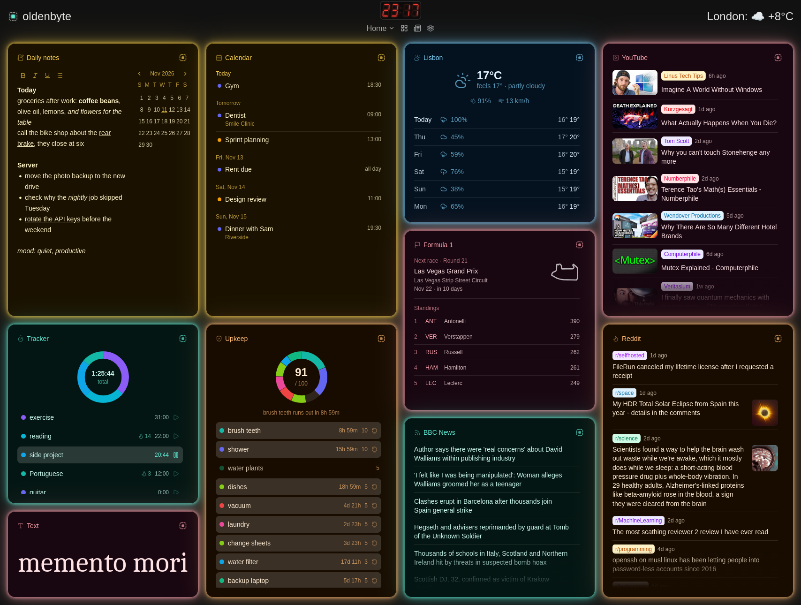
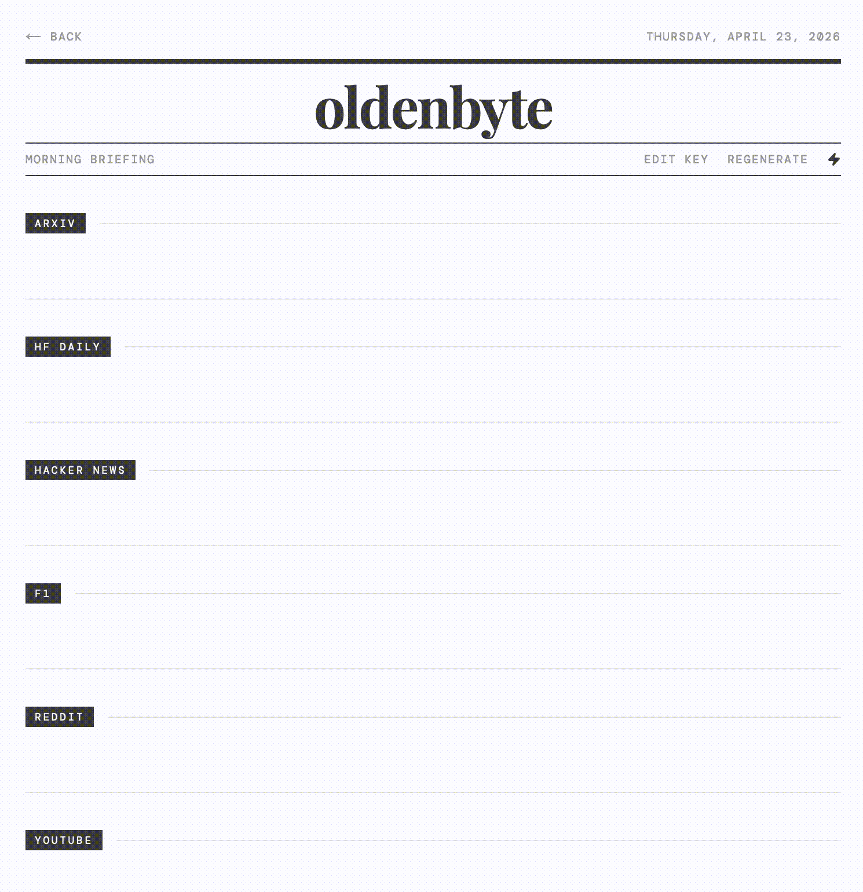

# oldenbyte

A self-hosted personal dashboard. Drag and resize widgets, keep several dashboards, and let a local AI assistant read what is on them.



## Highlights

- **Many dashboards**, each with its own layout. Group widgets as tabs, move them between dashboards.
- **Accounts**: the first visit creates the admin; others join with an invite code.
- **Keyboard driven**: press Space, then a widget's number or an action key. See [docs/keyboard.md](docs/keyboard.md).
- **AI assistant** for any OpenAI-compatible model (Ollama, LM Studio, llama.cpp, ...). It reads your widgets, Kiwix and Anytype on request, with characters that keep their own memory.
- **Morning digest** at `/digest`: a newspaper-style briefing of your widgets (below).
- **Your data**: Settings shows everything stored for your account. Backups export and import from edit mode.
- **Works on phones**: installs to the home screen like an app, with a zoomed-out overview of the whole dashboard and a floating button to jump between widgets. See [docs/mobile.md](docs/mobile.md).

## Widgets

| Kind | Widgets |
|---|---|
| **Feeds** | Feed (RSS, with favorites), Reddit, YouTube (with TubeArchivist), arXiv, HF Daily, Releases, Repository |
| **Notes** | Notepad (daily, with a calendar), Text, Todo, HTML (your own markup, sandboxed) |
| **Links** | Bookmarks, Search, Embed |
| **Time** | Calendar (CalDAV or a plain .ics link), Schedule, Clock |
| **Habits** | Tracker, Rhythm, Upkeep, Deficit |
| **Live** | Weather, F1, Football (a team or a league, live scores), Markets |
| **Library** | Reader (PDF and EPUB), Kiwix, Anytype |
| **Server** | Server stats, Monitor, Docker, DNS (AdGuard Home, Pi-hole), Changes (changedetection.io) |
| **Media** | TV (IPTV), Twitch |
| **Play** | Chess (Stockfish), Typing |
| **AI** | Chat |

New widgets can also be single JSON files in `widget-bank/`, no React needed. See [docs/widget-bank.md](docs/widget-bank.md). Add-ons connect a built-in widget to one more self-hosted service, also as a JSON file. See [docs/addons.md](docs/addons.md). Custom widgets are single HTML files that run sandboxed, uploaded from the picker or installed from the community catalog. See [docs/custom-widgets.md](docs/custom-widgets.md).

Each widget is documented in [docs/widgets/](docs/widgets/).

## Morning digest



`/digest` turns today's widget data into a newspaper-style briefing with any OpenAI-compatible model, one section per widget, written in parallel.

## Run it

With Docker:

```bash
echo "SESSION_SECRET=$(openssl rand -hex 32)" > .env
mkdir -p data && touch data/db.sqlite && chmod 666 data/db.sqlite
docker compose up -d
```

Open port `3847` and create the admin account. Data lives in `./data/`.

For development:

```bash
npm install
npm run dev        # http://localhost:3000
npm run typecheck && npm run lint && npm test
```

## Stack

Next.js 16, TypeScript, Tailwind CSS 4, Prisma with SQLite, react-grid-layout. Architecture, API, storage and deployment are in [docs/](docs/).

## Credits

- F1 circuit outlines by [Jules Roy](https://github.com/julesr0y/f1-circuits-svg), [CC BY 4.0](https://creativecommons.org/licenses/by/4.0/)
- [Stockfish](https://stockfishchess.org/) via [stockfish.js](https://github.com/nmrugg/stockfish.js), [GPL-3.0](https://www.gnu.org/licenses/gpl-3.0.html)

## License

Copyright (c) 2026 Cengiz Ozel. Licensed under the [GNU Affero General Public License v3.0](LICENSE): free to use, change and self-host; anyone who offers a modified version as a service must publish its source.
